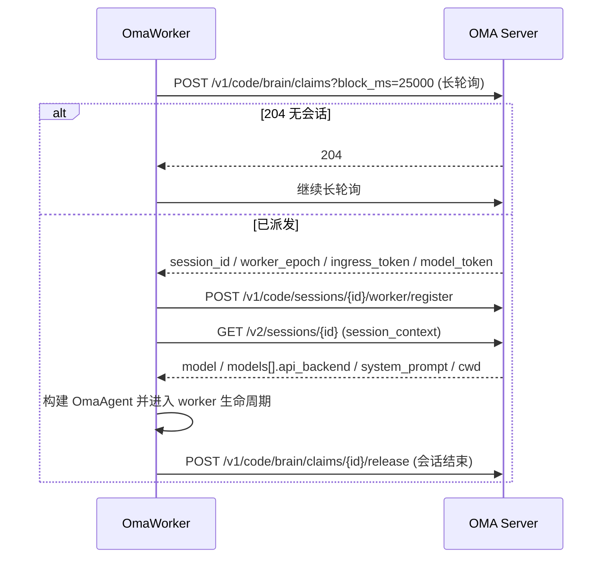
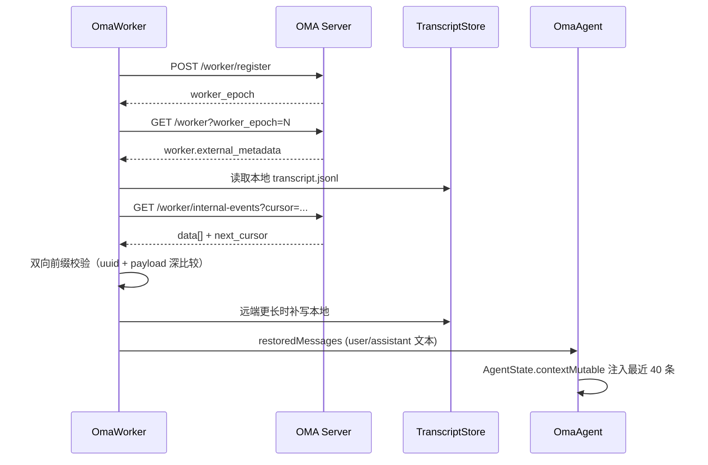

# OMA Harness SDK (Java)

把 OMA 的 worker 协议封装成可被任意 harness 装配的 SDK。harness 只需替换四个组件，就能接入 OMA 的沙箱、模型代理、凭据、文件挂载与 transcript。

生产代码统一使用 SLF4J API，由 Log4j2 实现（并保留 JUL→SLF4J 桥接兼容第三方库），控制台与滚动文件同时输出；文件路径默认 `/tmp/oma-harness/logs/harness.log`，可用 `-Doma.harness.log.dir=<dir>` 覆盖。关键路径（claim、上下文加载、工具注册、审批、工具调用与结果、transcript 同步、心跳失败）都有日志。

## 模块

| 模块 | 内容 | 是否框架相关 |
|---|---|---|
| `oma-harness-core` | 传输、事件映射、模型客户端、工具客户端、资源加载 | 否 |
| `oma-harness-agentscope` | 真实 AgentScope 适配层：`ReActAgent` + `ChatModelBase` + `AgentTool` | 是 |

## 装配方式

`oma-harness-agentscope` 直接依赖 `io.agentscope:agentscope-core`，推理循环由 AgentScope 的 `ReActAgent` 负责，OMA 侧只提供扩展点实现：

| AgentScope 扩展点 | OMA 实现 | 说明 |
|---|---|---|
| `ChatModelBase.doStream` | `OmaChatModel` | 全部模型调用走 OMA 代理；`/v1/messages` 遇到 `chat_completions` 后端时自动切 `/v1/chat/completions` 流式 |
| `AgentTool` | `OmaToolkit` | 按 `session_context.runtime_tools` 动态注册 `ToolCatalog` 中的工具，执行经 `ToolRunner` 走审批与 OMA 分发 |
| `ReActAgent` | `OmaAgent` | `agent.stream(...)` 驱动 ReAct 循环，`Event` 映射成 `CanonicalEvent` 后上行 |
| `HarnessAgent` | `OmaAgent` | `deliver` 消费 `user.message` / `user.interrupt` |

```java
OmaWorker worker = OmaWorker.builder()
        .endpoint(System.getenv("OMA_API_URL"))
        .claimToken(System.getenv("OMA_BRAIN_CLAIM_TOKEN"))
        .agentFactory(OmaAgent::new)
        .build();

worker.run();
```

`OmaAgent` 只做三件事：把 `user.message` 转成 `UserMessage` 交给 `agent.stream(...)`、把 `Event` 中的 text/tool_use/tool_result 映射为 OMA 事件、维护 turn 与 session 状态上报。循环次数（`maxIters`）与 prompt 由 AgentScope 决定；工具集合由服务端下发的 `runtime_tools` 决定。

工具清单（`tools/ToolCatalog`）：

| 模型可见名 | `runtime_tools` 名字 | 权限键 | 类型 | 执行路径 |
|---|---|---|---|---|
| `Bash` `Read` `Write` `Edit` `Grep` `Glob` | 同名 | `bash` `read` `write` `edit` `grep` `glob` | SANDBOX | `POST /v2/ccr-sessions/{id}/threads/{tid}/tool-calls` |
| `web_search` `web_fetch` | 同名 | `web_search` `web_fetch` | WEB | `POST .../web/search` `.../web/fetch` |
| `get_port_url` | `get_port_url` | `get_port_url` | PORT | `POST .../port-url` |
| `AskUserQuestion` | `ask_user_question` | `ask_user_question` | QUESTION | `can_use_tool` 的 `externalResult` |

审批规则与 dsh 一致：`runtime_tool_permissions[key] == allow` 直接执行，其余一律发 `control_request(subtype=can_use_tool)`。`updatedInput` 生效时在结果前追加 `OMA approval changed <tool> arguments to <json>`；`externalResult` 直接作为工具输出。`runtime_tools` 为空表示服务端没有下发 `agent_toolset_20260401`，此时不注册任何工具。`user.message.oma_refresh_tools == true` 时在回合开始前重新拉取 `GET /v2/sessions/{id}` 并同步工具与权限。

已知限制：工具执行依赖 OMA 沙箱。本地没有真实 sandbox 时，`tool-calls` 只会返回校验错误，模型只能拿着错误文本继续推理。

## 环境变量

只要求两个参数，其余全部在运行期从服务端获取：

| 变量 | 必需 | 说明 |
|---|---|---|
| `OMA_API_URL` | 是 | 例如 `http://127.0.0.1:48080` |
| `OMA_BRAIN_CLAIM_TOKEN` | 是 | 与服务端 `code_session.brain_claim_token_file` 一致 |

启动后按 DSH 的顺序动态获取：



| 运行期参数 | 来源 |
|---|---|
| `session_id` | claim 响应 |
| `worker_epoch` | claim 响应（`register` 后可被推进） |
| `ingress_token` | claim 响应 |
| `model_token` | claim 响应 |
| 模型名 | `session_context.model` |
| 模型后端 | `session_context.models[].api_backend`（`messages` / `chat_completions`） |
| system prompt | `session_context.system_prompt` + `append_system_prompt` |
| thread id | 主线程固定 `root` |
| 工具集合 | `session_context.runtime_tools` |
| 工具权限 | `session_context.runtime_tool_permissions`（`allow` / `ask` / `deny`） |

## 已实现的协议

| 能力 | 端点 | 说明 |
|---|---|---|
| worker 注册 | `POST /v1/code/sessions/{id}/worker/register` | 返回新 epoch |
| 事件流 | `GET .../worker/events/stream` | `client_event`，`id` 为 sequence |
| 事件上行 | `POST .../worker/events` | `{session_id, worker_epoch, events:[{payload, ephemeral}]}` |
| 投递回执 | `POST .../worker/events/delivery` | `received` / `processing`（60s 续期）/ `processed` |
| 状态上报 | `PUT .../worker` | `idle` / `running` / `requires_action` + `external_metadata` |
| 状态读取 | `GET .../worker` | 读回 `external_metadata`（model / pending_action / task_summary） |
| 心跳 | `POST .../worker/heartbeat` | 续租，返回 `worker_lease_expires_at` |
| internal-events 写 | `POST .../worker/internal-events` | 先写本地 JSONL 再上报，失败按 100ms→30s 退避重试 10 次 |
| internal-events 读 | `GET .../worker/internal-events` | `cursor` 分页回放，最多 10 页，逐次重试 10 次 |
| 子线程状态 | `GET .../worker/subagent-threads/{thread_id}` | 权威 `idle/running/rescheduling/terminated` |
| 控制面 | `control_request` / `control_response` / `keep_alive` | `initialize`、`set_model`、`can_use_tool` 审批 |
| 工具调用 | `POST /v2/ccr-sessions/{id}/threads/{tid}/tool-calls` | 提交 + `wait_ms` 长轮询 |
| 工具取消 | `POST .../tool-calls/{call_id}/cancel` | — |
| web 工具 | `POST .../web/search`、`.../web/fetch` | 35s 超时；`full_content` 落盘并回填 `output_file` |
| 端口 URL | `POST .../port-url` | 10s 超时，`port` 校验 1-65535 |
| 模型调用 | `POST /v1/messages` | `Bearer <model token>` + `X-OMA-Model-Purpose` |
| skills | `GET /v2/sessions/{id}/skills` | 目录与正文 |

主循环行为与 DSH 对齐：

- `register` 只执行一次；重连只重开 SSE，不重新注册（避免推进 epoch）
- 收到帧立刻回 `received`，进入 turn 回 `processing` 并每 60s 续期，结束回 `processed`
- `processed` 必须在 `result` 之前发送，否则服务端判定仍有未消费输入，丢弃 idle
- 每 1 秒由服务端校验 epoch，失效即断开
- 15 秒 keepalive 由服务端发送，客户端 45 秒无帧判定连接假死
- 断线指数退避（0.5s → 30s），10 分钟预算
- 401/403/404/409/410 视为终态，不重连
- `event_start` / `event_delta` 自动标记 `ephemeral`
- 所有 worker 请求带 `X-Worker-Epoch`；线程作用域请求带 `X-OMA-Session-Thread-ID`
- `PUT /worker` 在 300ms 窗口内对同一 body 去重，避免状态抖动放大请求
- 中断回合的 `result` 仍上报 `subtype=success`、`is_error=false`（服务端只看 `is_error`）

## 会话恢复

`claim` 成功后、`agent.start` 之前执行：



本地 transcript 位于 `${OMA_HARNESS_STATE_DIR:-~/.oma-harness}/sessions/{session_id}/transcript.jsonl`：首行 header（`version` / `session_id` / `created_at`），后续每行 `{seq, type, uuid, payload}`，追加后 `force(true)`。本地与远端互为前缀时按较长一方补齐；都不成立时抛 `Local and remote log histories diverged` 并终止会话，不会静默续写。

恢复只回放 `user` / `assistant` 文本。工具调用与结果由 OMA 公共事件承担，避免与 `agent.tool_use` 重复。

## 尚未实现

| 端点 | 影响 |
|---|---|
| `ANY .../mcp` | 外部 MCP 未代理 |
| `PUT/HEAD/GET .../worker/image-attachments/{sha256}` | 图片附件未上传 |
| `GET .../worker/message-attachments/{file_id}/content` | 用户消息附件未拉取 |
| `POST .../worker/diagnostics`、`otlp` | 无诊断与 trace 上报 |

这些都在 OMA 侧已有实现，SDK 只需补客户端方法，不涉及协议设计。`sign-commit`、`upstreamproxy` 与 session ingress 由沙箱内组件负责，不属于 harness。

## 需要按实际环境校准的两处

### 1. 事件 payload 字段

`OmaEventMapper` 按 OMA 的事件类型词表生成 payload，但每个类型的内部字段由服务端解析器校验，定义在 `internal/codesessions/worker_output_schema.go`。

首次接入时建议先用 `CanonicalEvent.Native` 直接发一条已知合法的事件，确认链路，再逐类替换为 canonical 映射：

```java
context.emitNative(Json.parse("{\"type\":\"agent.message\",\"uuid\":\"e1\",\"message\":{...}}"));
```

### 2. AgentScope 扩展点

当前适配层用到的扩展点与约束：

| 扩展点 | 本仓库用法 | 约束 |
|---|---|---|
| `Model` 可注入 | `OmaChatModel extends ChatModelBase` | 必须实现 `doStream` 与 `getModelName` |
| `Toolkit` 可委托 | `Toolkit.registerAgentTool(AgentTool)` | 工具执行异常不能抛穿，否则 ReAct 循环中断 |
| 事件流 | `agent.stream(msgs, StreamOptions, RuntimeContext)` | 用 `incremental(false)` 拿整块 text/tool_use |
| 中断入口 | `agent.interrupt(runtimeContext)` | 必须带 RuntimeContext，否则落到 `__anon__` 槽位不生效 |
| 历史注入 | `getAgentState(ctx).contextMutable()` | 仅在 `stateStore == null` 时保持有效 |

### 3. 模型后端选择

OMA 的 `/v1/messages` 只服务 `api_backend = messages` 的 provider；`deepseek` 这类 `chat_completions` 后端只在 brain 模式可用。`OmaModelClient` 首次调用失败且错误提到 `chat_completions`/`api_backend` 时，会切到 `/v1/chat/completions`（必须 `stream=true`）并复用同一 `model token`。

## 构建

```bash
mvn -B package
```

运行示例：

```bash
export OMA_API_URL=http://127.0.0.1:48080
export OMA_BRAIN_CLAIM_TOKEN=$(cat ../config/secrets/brain-claim-token)
mvn -B install -DskipTests
./scripts/run-harness.sh
```

不要用 `mvn exec:java` 启动：它会吞掉程序的 stdout/stderr，claim 与生命周期日志都看不到。脚本改为导出租户 classpath 后直接 `java -cp`，日志直通终端。

## 边界

`oma-harness-core` 只负责协议：把 OMA 的事件送进 harness，把 harness 的动作送回 OMA。agent loop、prompt、工具策略由框架层决定，当前落在 AgentScope 的 `ReActAgent` 上；`ContextCompacted` 事件用于让 OMA 的 transcript 知道压缩发生过。
