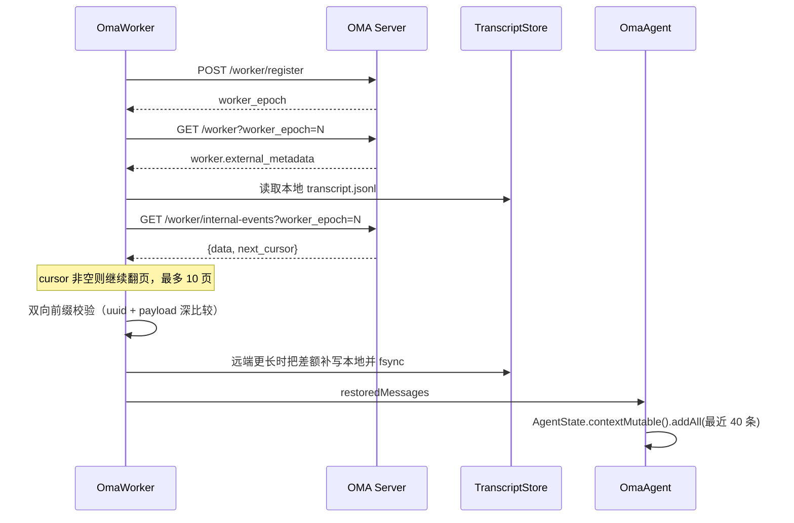
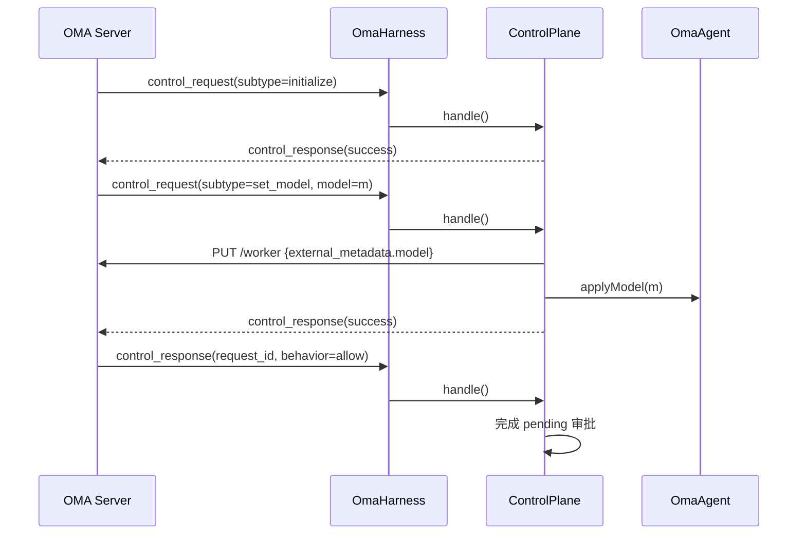
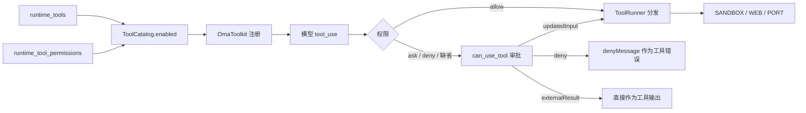
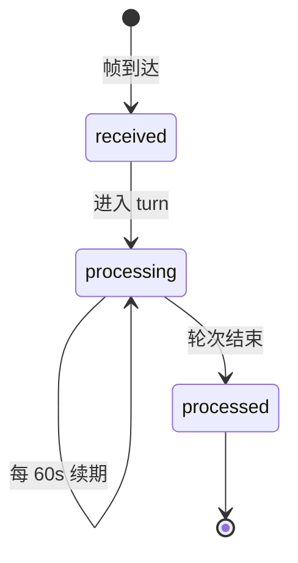
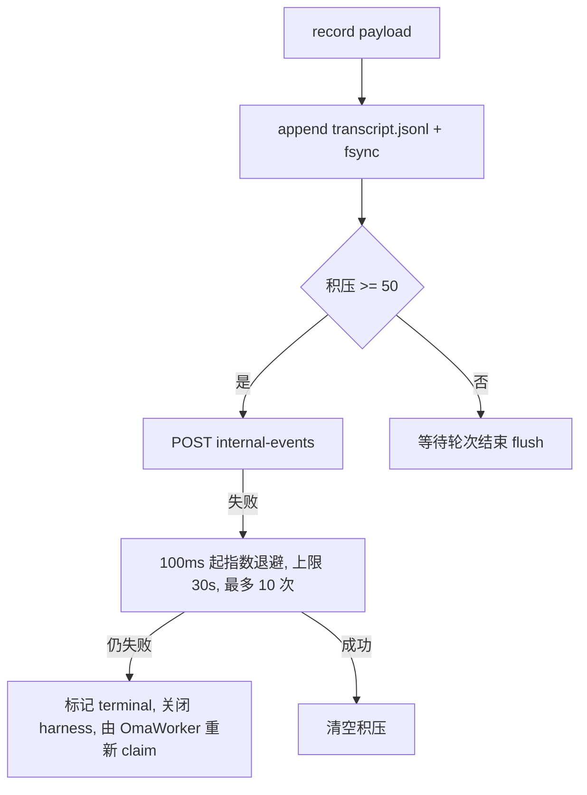

# Java Harness 的 CCRv2 客户端接入

本文描述 `oma-harness-core` 作为 CCRv2 worker 客户端时，对服务端 `internal/codesessions` 契约的覆盖范围、恢复流程、控制面、工具审批与本地持久化行为。协议语义以服务端代码与 `oma-brain-dsh` 为准，本文只说明 harness 侧如何落地。

## 0. SDK 分层

`oma-harness-core` 是面向 AgentScope 用户的接入 SDK（显式依赖 `io.agentscope:agentscope-core`），提供三类可复用能力：适配组件 `OmaChatModel`/`OmaToolkit`（`core/agentscope`）、规范基类 `OmaAgentSupport`（`core/agent`）、一站式入口 `OmaHarnessRunner`。用户实现自己的 `OmaAgent` 继承 support 并装配自有 Agent，core 保证协议规范不被绕过。`oma-harness-agentscope` 模块的 `OmaAgent`/`Main` 仅为参考实现。

`OmaAgentSupport` 只有单一扩展点：用户实现 `buildAgent(String systemPrompt)` 装配并返回 `ReActAgent`（core 持有并驱动），其余全部由 core 私有实现、用户不可覆写：`start` 的 chatModel/toolkit/refreshMcp/sync 顺序、`deliver` 的 turn envelope + `publishEvent` 去重、`applyModel`/`close` 生命周期，以及消息历史恢复（最后 `RESTORE_MESSAGE_LIMIT` 条、`assistant` 角色映射）、`streamEvents` 事件流驱动、`interrupt`、`close`。`streamTurn` 基于 AgentScope 2.0+ 的 `ReActAgent.streamEvents(msgs, RuntimeContext)`（旧 `stream(...)` 已废弃）；`publishEvent(AgentEvent)` 按 `TextBlockStart/Delta/End` 聚合文本、`ToolCallStart/Delta/End` 聚合工具入参、`ToolResultStart/Delta/End` 聚合工具输出，在 `End` 事件时分别发射 `MessageCompleted`/`ToolCallStarted`/`ToolCallCompleted`，`ToolResultDataDeltaEvent` 不进入 OMA 文本 content。ack 时序、稳定 `sevt_` id、interrupt 即时处理已在 `OmaHarness`/`OmaEventMapper` 实现，support 只保证不破坏它们。详见 README「快速接入」。

claim 释放 reason 必须为服务端白名单值 `admission_failed` / `shutdown` / `idle` / `permanent` 之一；`OmaWorker` 正常/空闲结束用 `idle`。用其它值（如 `finished`）会被服务端 400 拒绝，claim 只能靠 lease 过期兜底释放，造成会话释放延迟。

## 1. 覆盖范围

| 能力 | 端点 | 模块 |
|---|---|---|
| 领取 / 释放 | `POST /v1/code/brain/claims`、`.../{id}/release` | `claim/BrainClaimClient` |
| 注册 | `POST .../worker/register` | `transport/WorkerTransport` |
| 事件流 | `GET .../worker/events/stream` | `transport/WorkerTransport` + `SseParser` |
| 事件上行 | `POST .../worker/events` | `transport/WorkerTransport` |
| 投递回执 | `POST .../worker/events/delivery` | `transport/WorkerTransport` |
| 状态写 / 读 | `PUT / GET .../worker` | `transport/WorkerTransport` + `protocol/WorkerMetadata` |
| 心跳 | `POST .../worker/heartbeat` | `transport/WorkerTransport` |
| transcript 写 / 读 | `POST / GET .../worker/internal-events` | `persistence/InternalEventStore` + `persistence/TranscriptStore` |
| 子线程状态 | `GET .../worker/subagent-threads/{thread_id}` | `transport/WorkerTransport` |
| 控制面 | `control_request` / `control_response` / `keep_alive` | `protocol/ControlPlane` |
| 工具调用 | `POST / GET / .../cancel` on `/v2/ccr-sessions/{id}/threads/{tid}/tool-calls` | `tools/OmaToolClient` + `tools/ToolRunner` |
| web 工具 | `POST .../web/search`、`.../web/fetch` | `tools/OmaWebClient` |
| 端口 URL | `POST .../port-url` | `tools/OmaPortClient` |
| 会话上下文 | `GET /v2/sessions/{id}`、`/skills` | `claim/SessionContext`、`resources/OmaResourceLoader` |

不在 harness 职责内：`sign-commit`、`/v1/code/upstreamproxy/*`、`POST/PUT /v1/code/sessions/{id}`、`/v1/code/sandbox/tool-calls/*`。它们分别由沙箱内的 environment-manager、relay 与 sandbox manager 使用。

## 2. 会话恢复

`claim` 成功后、`agent.start` 之前完成恢复，保证首轮对话就能看到历史。

约束：

- 恢复只回放 `payload.type` 为 `user` / `assistant` 的文本消息。工具调用与结果由 OMA 公共事件承担，重复回放会与 `agent.tool_use` 冲突。
- 恢复完成后把已见 `payload.uuid` 写入去重集合，避免本轮再次上报同一条；本地存在而远端缺失的尾部会重新进入上传队列。
- `external_metadata.model` 存在时优先于 `session_context.model`，保证 `set_model` 在重启后仍然生效。
- 注入依赖 `stateStore == null`。若后续接入 `AgentStateStore`，需改为在 store 层合并，不能再用 `contextMutable`。
- 本地与远端历史互不为前缀时抛 `Local and remote log histories diverged`，`recover()` 不再降级，worker 释放 claim 后由 `OmaWorker` 重新领取。

## 3. 控制面

- `initialize`：直接回 `success`，不回填 system prompt；system prompt 在 harness 启动时由 `SessionContext.load` 拉取 session context 后一次性组装（见「System prompt 组装」）。

## System prompt 组装

与 DSH `prompt/assemble.ts` + `prompt/platform.ts` 对齐，harness 不依赖本地兜底 prompt，而是启动时由 `SystemPromptAssembler.assembleRoot` 分层组装，各层 trim 后以 `\n\n` 连接、跳过空层：

1. 本地 platform rules（`rootPlatformPrompt`）：一段内置的运行时规则（situation / asking / working / approvals / trust / finishing）。按 session context 是否下发 `subagents` 决定用 `Delegating to subagents`（含 `MAX_LIVE_SUBAGENT_THREADS=25`）还是 `Subagents disabled`；`subagents.inlineAgents=false` 时追加"仅允许预定义 agent"约束。
2. environment prompt：server 的 `append_system_prompt`（`# Managed-agent environment`，含沙箱路径/网络/持久化规则）。
3. agent instructions：server 的 `system_prompt` / `custom_system_prompt`，包在 `# Agent instructions` 标题下。
4. session：`<cwd>` 写成 `# This session\n\nWorking directory: <cwd>`，后接 `memory_catalog_prompt`。
5. skills：`assembleRoot(session, List<Skill>)` 在当前会话存在 `modelInvocable` 的 skill 时追加 `# Available skills` 摘要（`- name: description`），并提示用 `load_skill(name)` 读取正文；无可用 skill 时不追加该层。

`SessionContext` 分别暴露 `agentInstructions()` / `environmentPrompt()` / `memoryCatalogPrompt()` / `cwd()` / `subagents()` / `runtimeSkills()`；原 `systemPrompt()` 保留为拼接兼容字段，不再作为最终 prompt。skills 由 `AgentContext.skills()`（`GET /v2/sessions/{id}/skills`）提供，`OmaSkillTool`（框架内置、不受 runtime_tools 白名单约束）按名称返回 skill 的 `content` 作为 SKILL.md 正文，对齐 DSH 的 ToolSkill 语义。单测 `SystemPromptAssemblerTest`、`OmaSkillToolTest` 锁定层顺序、skill 过滤与按需加载。
- `set_model`：先 `PUT /worker` 落 `external_metadata.model`，成功后再切换 `OmaChatModel`，最后回 `success`。任何一步失败都回 `error`，避免服务端与 harness 模型状态分叉。
- 上行审批：`control_request` 只发 `subtype=can_use_tool`，携带 `tool_name`、`tool_use_id` 与原始 `input`；`control_response` 解析 `behavior`、`updatedInput`、`message`/`denyMessage`、`externalResult`。
- 审批状态：发出审批请求时 `PUT /worker` 报 `worker_status=requires_action` 并带 `requires_action_details`（tool_name/tool_use_id/session_thread_id）；审批结束（回答、超时、中断）且无其它待审批时恢复 `running`。
- 审批说明：允许且带 `updatedInput` 时发 `system.message`（`Approved <tool> arguments: ...`），拒绝或响应失败时发拒绝说明，供前端展示审批变更。
- 审批超时（5 分钟）按 `deny` 收尾并从等待表移除；中断时 `interruptApprovals` 让所有待审批调用立即以 `Tool call interrupted.` 结束。
- 中断：`control_request.subtype=interrupt` 与顶层 `user.interrupt` 都按中断处理，必须在 SSE 读循环线程立即执行，不能排进轮次队列。
- 回合失败：`agent.deliver` 抛异常时上报 `result{is_error:true, subtype:error_max_turns}`，后端据此生成 `session.error` 与 `stop_reason=retries_exhausted` 的 idle；成功时仍发 `subtype=success`。

### 流式响应

前端逐 token 展示依赖 OMA 的 stream_event 预览协议，链路完整实现在 core：

- 模型层：`ChatCompletionsClient.send` 在读 SSE 时对文本与推理（`reasoning_content`/`reasoning`）chunk 分别回调；`OmaChatModel.doStream` 把文本 chunk 转成 `TextBlock`、推理 chunk 转成 `ThinkingBlock` 即时发出，`thinking`/`redacted_thinking` 内容块与工具调用块在流结束后统一发。
- 事件层：`StreamEventPublisher` 把 AgentScope 的 `TextBlockStart/Delta/End`、`ThinkingBlockStart/End` 转成 `message_start` / `content_block_start` / `content_block_delta` / `content_block_stop` / `message_stop` 序列，以 ephemeral `stream_event` 上报；后端 `workerPreviewConverter` 转为 `event_start` + `event_delta(content_delta)` 推给前端。thinking 正文的增量被后端主动丢弃（DSH 同样），前端只显示占位思考块。
- 收敛：最终 `MessageCompleted` / `ThinkingDelta` 的 id 由 `StableAssistantEventID` 公式（`codeSessionId` + `messageID` + content block index + event type）计算，与预览 `event_id` 一致，前端据此把增量帧收敛到最终消息。

## 4. 工具下发与审批

工具集合完全由 `session_context` 决定，harness 不再维护写死的工具列表：

| 模型可见名 | `runtime_tools` 名字 | 权限键 | 类型 | 远程名 |
|---|---|---|---|---|
| `Bash` `Read` `Write` `Edit` `Grep` `Glob` | 同名 | `bash` `read` `write` `edit` `grep` `glob` | SANDBOX | `bash` `read` `write` `edit` `grep` `glob` |
| `web_search` `web_fetch` | 同名 | `web_search` `web_fetch` | WEB | `search` `fetch` |
| `get_port_url` | `get_port_url` | `get_port_url` | PORT | `port-url` |
| `AskUserQuestion` | `ask_user_question` | `ask_user_question` | QUESTION | — |

规则：

- 名称匹配对大小写、下划线与连字符不敏感，因此 `AskUserQuestion` 能命中 `ask_user_question`。
- `runtime_tools` 为空表示服务端没有下发 `agent_toolset_20260401`，此时不注册任何工具；权限为 `deny` 的工具同样不进入模型可见列表。
- 权限缺省为 `ask`。`allow` 直接执行；其他情况一律发 `can_use_tool`，因此 `deny` 与「未配置」在 harness 侧行为一致。
- `updatedInput` 与原始入参不同时，结果前追加 `OMA approval changed <tool> arguments to <json>. The returned result is for these approved arguments.`。
- `AskUserQuestion` 只接受 `externalResult`：缺少时报 `Missing user question result`；答案要求数量与 id 一一对应、`selected` 去重且属于 `options[].label`、单选不允许同时给选项与自定义答案。
- `web_search` / `web_fetch` 超时 35s；响应含 `full_content` 时通过 `Write` 工具把 `{...page, content: full_content, truncated: false}` 写入 `/tmp/tool-outputs/mcp_<uuid>.txt` 并回填 `output_file`，写失败只留预览并给出 `storage_error`。
- `get_port_url` 先校验 `1 <= port <= 65535`，再以 10s 超时请求服务端；错误文案与服务端一致（`OMA port URL HTTP <status>: <message>`）。
- **动态配置对齐（每条 user.message 入口）**：`OmaAgentSupport.applyConfigIfChanged` 用 `X-OMA-Session-Thread-ID` 拉取一次 `GET /v2/sessions/{id}`，计算 `SessionContext.signature()`（覆盖 system prompt 各层、cwd、runtime_tools、mcp_config、subagents、runtime_skills）。签名变化才刷新 MCP、`toolkit.sync`、重拼 prompt 并重建 `ReActAgent`（从旧 agent state 迁移完整消息历史、保留去重状态与 streamPublisher）。签名未变但带 `oma_refresh_tools=true`（服务端 `system_context.go` 对每条 user.message 无条件注入，DSH 兼容）时只同步 MCP/工具/skill 索引，不重建 agent；签名未变且无该标记时只更新 session 引用。这样既保留"每条消息刷新工具"的 DSH 语义，又避免每轮无谓重建。
- 每次模型请求前的 `refreshPermissions` 在同一轮内复用入口已拉取的 session_context，不重复请求；非 user.message 触发的模型调用（如 compaction）仍会兜底拉取。
- `SessionContext.refresh` 可通过 `OmaAgentSupport.refreshSession()` 覆写，便于测试注入固定上下文。
- 会话上下文解析 fail-closed：`runtime_tools` 元素非字符串、`runtime_tool_permissions` 值不在 `allow|ask|deny` 内都视为协议错误，直接终止当前会话。

## 5. 投递回执状态机

`processed` 必须先于 `result` 事件发送。原因见 `internal/db/session_event_mapper.xml` 的 `HasInputBlockingIdle`：只要还存在 `processed_at IS NULL` 的 `user.message`，服务端就会丢弃 idle 状态转换，且不返回错误。

中断回合的 `result` 仍上报 `subtype=success`、`is_error=false`，与 dsh `session.ts` 的 `afterRun` 分支一致；服务端事件映射只看 `is_error`。

`agent.message` / `agent.thinking` 必须携带模型代理返回的 `Request-Id`（即 `model_request_start_id`）与 `uuid`。服务端用 `request_id + 文本摘要` 对 proxy 与 worker 两条回声去重；缺少这两个字段会让前端把同一段回答显示两次。

`agent.tool_use` 与 `agent.tool_result` 的 id 不能用原始 `call_` id。模型代理会为每个工具调用回显一条 `agent.tool_use`，其 id 由 `ToolUseEventID(code_session_id, tool_use_id, thread_id)` 生成（`sevt_` + SHA-256 前 16 字节；root 线程不带 thread 段）。harness 必须用同一算法生成 `agent.tool_use.id`，并让 `agent.tool_result.tool_use_id` 引用同一稳定 id，否则前端按 id 合并失败，把同一工具调用显示两次。服务端 echo 去重白名单仅覆盖 `agent.message` / `agent.thinking`，不会替 tool 事件去重，因此稳定 id 是避免重复的唯一手段。算法见 `OmaEventMapper.toolUseEventId`，与服务端 `internal/managedagentsevents/identity.go` 的 `ToolUseEventID` 对齐。

## 6. 本地 transcript 与远端同步

- 路径：`${OMA_HARNESS_STATE_DIR:-~/.oma-harness}/sessions/{session_id}/transcript.jsonl`。
- 格式：首行 header（`version`、`session_id`、`created_at`），后续每行 `{seq, type, uuid, payload}`；`seq` 从 0 单调递增。
- 写入：`FileChannel` 追加后 `force(true)`；写入失败截断回写前长度，避免半行破坏 `seq` 连续性；启动时修复缺失换行的尾部。
- 顺序：先本地落盘，再上报远端。远端失败不影响本地，但会阻塞本轮确认直至重试耗尽。
- 校验：本地与远端逐条比较 `uuid` 与 `payload`（对象键序无关的深比较）；只有互为前缀时才允许补齐或补传。

### 上下文压缩

长会话由 core 在每轮 `user.message` 推理前统一执行压缩检查（接入方仍只需实现 `buildAgent`），算法移植自 AgentScope harness 2.0.4 的 `ConversationCompactor`，但不依赖其 workspace / memory / offload 组件：

- 触发：对话条数达到 `triggerMessages`（默认 50），或估算 token 达到动态阈值（`contextWindowSize - reserved`，模型未上报窗口时回退 160000）。
- 处理：按 `keepMessages` / `keepTokens` 计算切分点并避开工具调用对；摘要前对超大工具结果和工具入参做轻量裁剪；把前缀经一次 `purpose=compaction` 的模型请求压成结构化摘要，与保留尾部一起写回 `AgentState.contextMutable()`。
- 持久化：压缩只改变工作上下文，本地 transcript 仍保留全量原文；摘要以带 `<compacted-summary>` 标记的标准 `user` 消息落盘（附 `dropped_messages`），进程重启后识别标记恢复为摘要消息并参与后续累计压缩。用标准 `user` 类型是为了通过后端 internal event 白名单校验（仅接受 user/assistant/attachment/system/dsh_log），确保本地记录能正常补传到远端。
- 事件：压缩成功后上报 `agent.thread_context_compacted`（`summary`、`dropped_messages`）；摘要请求失败或中断时记 warn 并跳过本轮压缩，不阻断回合。
- 配置：默认开启，`OMA_HARNESS_COMPACTION_ENABLED=false`（系统属性或环境变量）可关闭；`OMA_HARNESS_COMPACTION_TRIGGER_MESSAGES=<n>` 可覆盖默认触发条数（默认 50）；接入方可覆写 `OmaAgentSupport.compactionConfig()` 调整阈值、尾部保留与摘要 prompt。

## 7. 与 oma-brain-dsh 的差异

| 项 | dsh | Java harness |
|---|---|---|
| transcript 存储 | 原生动 JSONL（`dsh_log` session 事件 + 前缀校验 + 锁） | 本地 JSONL（`{seq,type,uuid,payload}`）+ 远端前缀校验，无跨进程锁 |
| 压缩 | 有 compaction | 已具备：回合边界按条数/估算 token 触发 LLM 摘要压缩，保留近期原文；复用 AgentScope 原生算法，摘要经 OMA 代理以 `purpose=compaction` 请求；压缩结果写回 agent state、以带标记的标准 user 消息落盘并上报 `agent.thread_context_compacted`。不做 memory flush / JSONL offload（本地 transcript 已全量保留原文），无溢出后自动重试 |
| 工具来源 | `launch.tools` / `runtime_tools` | 同源，`ToolCatalog` 按 `runtime_tools` 注册 |
| 审批 | 完整 `can_use_tool` 流程 | 同流程；`deny` 与未配置都走审批 |
| 重启重试 | 无最大次数，409/410 置 `terminal` | 最多 10 次后置 `terminal` |
| 子线程 | 有创建与状态机 | 只读权威状态（GET `subagent-threads/{id}`，按 epoch 作用域） |
| 诊断 | 本地 console + OTel | SLF4J + Log4j2；结构化诊断经 `DiagnosticsReporter` 白名单上报，OTel 经 `OtlpExporter` |
| 外部 MCP | SDK 经 `/v2/ccr-sessions/{id}/mcp?mcp_url=` 代理 | 手写 MCP JSON-RPC over 同一代理端点，三种 transport 均统一为 JSON-RPC 消息 |

## 8. 外部 MCP 代理链路

`session_context.mcp_config.mcpServers` 由服务端下发，harness 在启动时与收到 `oma_refresh_tools` 时通过 `ExternalMcpRegistry.refresh` 发现工具。

- 配置解析（`McpServerConfig`）：支持 `http` / `streamable-http` / `sse`；URL 必须绝对 http(s) 且不含 userinfo/fragment；`headers` 值必须是字符串；`tools[].enabled=false` 进 `disabledTools`；prefix 对简单名做 `.`→`_`，复杂名用 SHA-256 前 24 hex 字符加 `mcp_` 前缀；prefix 冲突或任意字段非法按 `invalid_mcp_config` fail-closed 终止会话。
- 工具命名：每个远程工具注册为 `mcp__<prefix>__<remoteName>`（`McpServerConfig.toolName`），作为 `ToolCatalog.ToolSpec(Kind.MCP)` 加入 toolkit，走既有 `runtime_tool_permissions` 与 `can_use_tool` 审批链，缺省 `ask`。
- 代理链路（`ExternalMcpClient`）：每个 MCP JSON-RPC 请求（`initialize`、`notifications/initialized`、`tools/list`、`tools/call`）以 `POST` 发送到 `config.sessionBase() + "/mcp?mcp_url=<urlencoded>"`，带 `Authorization: Bearer <ingress_token>`、非 root 线程带 `X-OMA-Session-Thread-ID`，初始化后带 `Mcp-Session-Id`；Go 代理透明转发并做凭据注入与结果持久化。响应兼容 `application/json` 与 `text/event-stream`（解析 `data:` 行）。initialize 30s、list 30s、call 185s。
- 可靠性：401/403 标记 authFailed 并拒绝后续调用；带 `Mcp-Session-Id` 的请求遇 404 标记 sessionRejected，`ExternalMcpRegistry` 关闭旧客户端、重连、`tools/list` 后用 name + inputSchema 深比较校验，未变才重放，否则返回 isError；`X-Oma-Mcp-Not-Forwarded` 映射为 isError 文案（截取 500 字符）；非文本 content（image/audio/resource）返回 isError。
- 大结果落盘（`ToolRunner.persistIfLarge`）：文本超过 100000 字符时经沙箱 `Write` 落盘到 `/tmp/tool-outputs/mcp_<uuid>.txt`，返回 `<persisted-output>` 包装，含头 1000 + 尾 1000 字符预览，防止上下文膨胀。
- 并发发现：多 server 用 `CompletableFuture.allOf` 并发，单 server 失败只记 WARN 并隔离；按 `mcp_config` 的规范化签名变化优雅重建客户端。

## 9. 辅助接口

- activity：每 30s 发送 `type=keep_alive` 的 ephemeral 公开事件；有活跃流时发送，不进入 durable outbox。
- delivery-progress：收到事件立即回 `received`，处理中每 60s 续期 `processing`，完成回 `processed`（`processed` 先于 turn result）。
- diagnostics：`DiagnosticsReporter` 仅上报白名单种类（`oma_runtime_event` / `oma_model_request_retry` / `oma_runtime_input_failed`），由 `OMA_OBSERVABILITY_ENABLED` 开关控制，默认只写日志。
- OTLP：`OtlpExporter` 对 `otlp/v1/logs`、`otlp/v1/traces` 转发 OTLP/JSON，同样受 `OMA_OBSERVABILITY_ENABLED` 控制，默认 no-op；单批超 8MB 丢弃并记 DEBUG。
- 附件：`AttachmentStore` 通过 `image-attachments/{sha256}` PUT 上传（SHA-256 命名），`message-attachments/{file_id}/content` GET 读取，均带 epoch 栅栏。用户消息的 `image` 块由 `UserContentResolver` 处理：`file` 来源经 GET 读取私有附件后 base64 编码，`base64` 来源直接内联，`url` 来源保持 URL；统一转为 AgentScope `ImageBlock` 并注入 `UserMessage`，纯图片消息也启动回合。模型请求按 backend 序列化为 Anthropic image block 或 OpenAI `image_url` data URL；附件缺失/解码失败单张降级跳过，transcript 与 internal events 只保留文本、不落图片字节。模型返回的图片块由 `ImageBlocks` 解析（含 OpenAI data URL / `images` 扩展字段），经 `finalBlocks()` 转为 AgentScope `ImageBlock` 进入最终 `ChatResponse.content`；但 AgentScope 无图片事件、DSH assistant 转换过滤非文本块、前端 trace 仅渲染文本，故输出图片暂不在前端消息时间线显示为图片（需另行打通 DSH/前端）。
- batch-uploader / retry：`InternalEventStore` 的 100ms 起、30s 上限、10 次退避与现有 PUT 去重窗口等价覆盖，未抽取为独立通用组件。

## 9. 验收

- 单测：`WorkerMetadataTest`、`ControlPlaneTest`（含审批超时与中断）、`TranscriptTest`、`ToolCatalogTest`、`ToolRunnerTest`（含 MCP 分发与大结果落盘）、`TranscriptStoreTest`、`InternalEventStoreTest`、`OmaWebClientTest`、`McpServerConfigTest`（解析/命名/fail-closed）、`ExternalMcpClientTest`（JSON/SSE 响应解析）。
- 端到端：把某工具权限配成 `ask`，验证前端确认的允许 / 拒绝 / 改参三条路径；调用 `AskUserQuestion` 验证答案回传；调用 `web_search` 与 `get_port_url`；重启 harness 验证本地 transcript 与远端对齐；手工制造分叉验证 `Local and remote log histories diverged`。
- MCP 端到端：用 `scripts/mcp-mock/` 的 mock server，通过 server API 建 agent 并把 `mcp_config.mcpServers` 指向 mock；验证工具发现为 `mcp__prefix__tool`、disabled 工具不出现、调用经 `/v2/ccr-sessions/{id}/mcp?mcp_url=` 代理、超长结果落盘、事件稳定 `sevt_` id 不重复。
