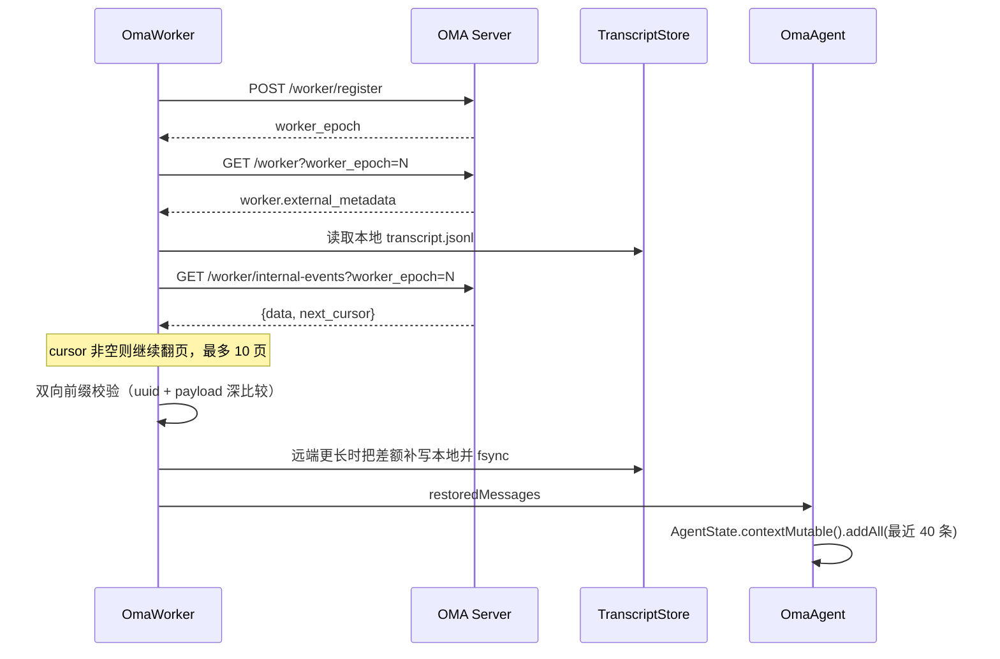
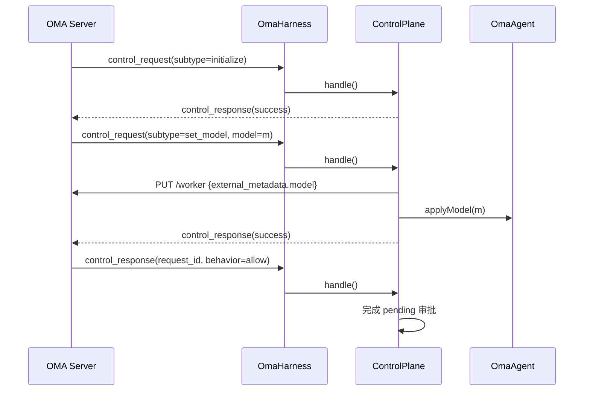
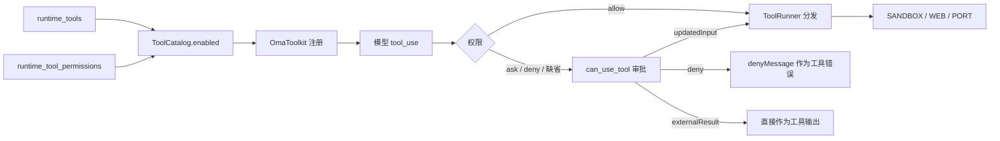
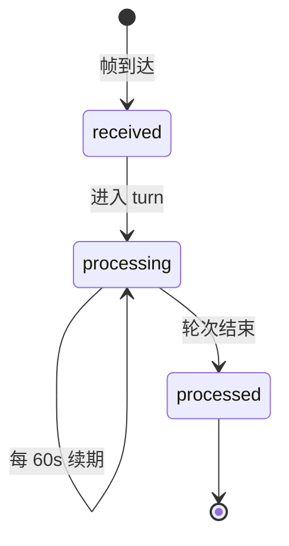
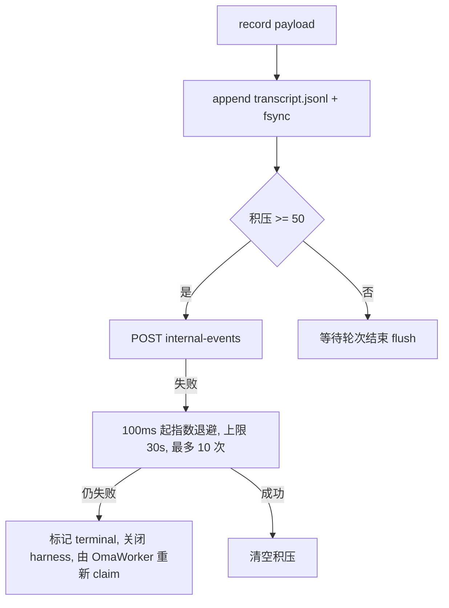

# Java Harness 的 CCRv2 客户端接入

本文描述 `aca/oma-harness-core` 作为 CCRv2 worker 客户端时，对服务端 `internal/codesessions` 契约的覆盖范围、恢复流程、控制面、工具审批与本地持久化行为。协议语义以服务端代码与 `oma-brain-dsh` 为准，本文只说明 harness 侧如何落地。

## 1. 覆盖范围

| 能力 | 端点 | 模块 |
|---|---|---|
| 领取 / 释放 | `POST /v1/code/brain/claims`、`.../{id}/release` | `claim/BrainClaimClient` |
| 注册 | `POST .../worker/register` | `transport/WorkerTransport` |
| 事件流 | `GET .../worker/events/stream` | `transport/WorkerTransport` + `SseParser` |
| 事件上行 | `POST .../worker/events` | `transport/WorkerTransport` |
| 投递回执 | `POST .../worker/events/delivery` | `transport/WorkerTransport` |
| 状态写 / 读 | `PUT / GET .../worker` | `transport/WorkerTransport` + `protocol/WorkerMetadata` |
| 心跳 | `POST .../worker/heartbeat` | `transport/WorkerTransport` |
| transcript 写 / 读 | `POST / GET .../worker/internal-events` | `persistence/InternalEventStore` + `persistence/TranscriptStore` |
| 子线程状态 | `GET .../worker/subagent-threads/{thread_id}` | `transport/WorkerTransport` |
| 控制面 | `control_request` / `control_response` / `keep_alive` | `protocol/ControlPlane` |
| 工具调用 | `POST / GET / .../cancel` on `/v2/ccr-sessions/{id}/threads/{tid}/tool-calls` | `tools/OmaToolClient` + `tools/ToolRunner` |
| web 工具 | `POST .../web/search`、`.../web/fetch` | `tools/OmaWebClient` |
| 端口 URL | `POST .../port-url` | `tools/OmaPortClient` |
| 会话上下文 | `GET /v2/sessions/{id}`、`/skills` | `claim/SessionContext`、`resources/OmaResourceLoader` |

不在 harness 职责内：`sign-commit`、`/v1/code/upstreamproxy/*`、`POST/PUT /v1/code/sessions/{id}`、`/v1/code/sandbox/tool-calls/*`。它们分别由沙箱内的 environment-manager、relay 与 sandbox manager 使用。

## 2. 会话恢复

`claim` 成功后、`agent.start` 之前完成恢复，保证首轮对话就能看到历史。

约束：

- 恢复只回放 `payload.type` 为 `user` / `assistant` 的文本消息。工具调用与结果由 OMA 公共事件承担，重复回放会与 `agent.tool_use` 冲突。
- 恢复完成后把已见 `payload.uuid` 写入去重集合，避免本轮再次上报同一条；本地存在而远端缺失的尾部会重新进入上传队列。
- `external_metadata.model` 存在时优先于 `session_context.model`，保证 `set_model` 在重启后仍然生效。
- 注入依赖 `stateStore == null`。若后续接入 `AgentStateStore`，需改为在 store 层合并，不能再用 `contextMutable`。
- 本地与远端历史互不为前缀时抛 `Local and remote log histories diverged`，`recover()` 不再降级，worker 释放 claim 后由 `OmaWorker` 重新领取。

## 3. 控制面

- `initialize`：直接回 `success`，不回填 system prompt；system prompt 在 harness 启动时由 `SessionContext.load` 拉取 session context 后一次性组装（见「System prompt 组装」）。

## System prompt 组装

与 DSH `prompt/assemble.ts` + `prompt/platform.ts` 对齐，harness 不依赖本地兜底 prompt，而是启动时由 `SystemPromptAssembler.assembleRoot` 分层组装，各层 trim 后以 `\n\n` 连接、跳过空层：

1. 本地 platform rules（`rootPlatformPrompt`）：一段内置的运行时规则（situation / asking / working / approvals / trust / finishing）。按 session context 是否下发 `subagents` 决定用 `Delegating to subagents`（含 `MAX_LIVE_SUBAGENT_THREADS=25`）还是 `Subagents disabled`；`subagents.inlineAgents=false` 时追加"仅允许预定义 agent"约束。
2. environment prompt：server 的 `append_system_prompt`（`# Managed-agent environment`，含沙箱路径/网络/持久化规则）。
3. agent instructions：server 的 `system_prompt` / `custom_system_prompt`，包在 `# Agent instructions` 标题下。
4. session：`<cwd>` 写成 `# This session\n\nWorking directory: <cwd>`，后接 `memory_catalog_prompt`。

`SessionContext` 分别暴露 `agentInstructions()` / `environmentPrompt()` / `memoryCatalogPrompt()` / `cwd()` / `subagents()`；原 `systemPrompt()` 保留为拼接兼容字段，不再作为最终 prompt。单测 `SystemPromptAssemblerTest` 锁定层顺序、subagents 开关与空层跳过。
- `set_model`：先 `PUT /worker` 落 `external_metadata.model`，成功后再切换 `OmaChatModel`，最后回 `success`。任何一步失败都回 `error`，避免服务端与 harness 模型状态分叉。
- 上行审批：`control_request` 只发 `subtype=can_use_tool`，携带 `tool_name`、`tool_use_id` 与原始 `input`；`control_response` 解析 `behavior`、`updatedInput`、`message`/`denyMessage`、`externalResult`。
- 审批超时（5 分钟）按 `deny` 收尾并从等待表移除；中断时 `interruptApprovals` 让所有待审批调用立即以 `Tool call interrupted.` 结束。
- 中断：`control_request.subtype=interrupt` 与顶层 `user.interrupt` 都按中断处理，必须在 SSE 读循环线程立即执行，不能排进轮次队列。

## 4. 工具下发与审批

工具集合完全由 `session_context` 决定，harness 不再维护写死的工具列表：

| 模型可见名 | `runtime_tools` 名字 | 权限键 | 类型 | 远程名 |
|---|---|---|---|---|
| `Bash` `Read` `Write` `Edit` `Grep` `Glob` | 同名 | `bash` `read` `write` `edit` `grep` `glob` | SANDBOX | `bash` `read` `write` `edit` `grep` `glob` |
| `web_search` `web_fetch` | 同名 | `web_search` `web_fetch` | WEB | `search` `fetch` |
| `get_port_url` | `get_port_url` | `get_port_url` | PORT | `port-url` |
| `AskUserQuestion` | `ask_user_question` | `ask_user_question` | QUESTION | — |

规则：

- 名称匹配对大小写、下划线与连字符不敏感，因此 `AskUserQuestion` 能命中 `ask_user_question`。
- `runtime_tools` 为空表示服务端没有下发 `agent_toolset_20260401`，此时不注册任何工具；权限为 `deny` 的工具同样不进入模型可见列表。
- 权限缺省为 `ask`。`allow` 直接执行；其他情况一律发 `can_use_tool`，因此 `deny` 与「未配置」在 harness 侧行为一致。
- `updatedInput` 与原始入参不同时，结果前追加 `OMA approval changed <tool> arguments to <json>. The returned result is for these approved arguments.`。
- `AskUserQuestion` 只接受 `externalResult`：缺少时报 `Missing user question result`；答案要求数量与 id 一一对应、`selected` 去重且属于 `options[].label`、单选不允许同时给选项与自定义答案。
- `web_search` / `web_fetch` 超时 35s；响应含 `full_content` 时通过 `Write` 工具把 `{...page, content: full_content, truncated: false}` 写入 `/tmp/tool-outputs/mcp_<uuid>.txt` 并回填 `output_file`，写失败只留预览并给出 `storage_error`。
- `get_port_url` 先校验 `1 <= port <= 65535`，再以 10s 超时请求服务端；错误文案与服务端一致（`OMA port URL HTTP <status>: <message>`）。
- `user.message.oma_refresh_tools == true` 时，回合开始前用 `X-OMA-Session-Thread-ID` 重新拉取 `GET /v2/sessions/{id}`，同步 `runtime_tools` 与权限：新增工具注册、消失工具移除。
- 每次模型请求前都会重新拉取 `runtime_tool_permissions`（对齐 dsh 的 `agent/request` 钩子），因此前端修改权限后下一轮即生效；`runtime_tools` 只在 `oma_refresh_tools` 时同步，避免模型可见工具在回合中途变化。
- 会话上下文解析 fail-closed：`runtime_tools` 元素非字符串、`runtime_tool_permissions` 值不在 `allow|ask|deny` 内都视为协议错误，直接终止当前会话。

## 5. 投递回执状态机

`processed` 必须先于 `result` 事件发送。原因见 `internal/db/session_event_mapper.xml` 的 `HasInputBlockingIdle`：只要还存在 `processed_at IS NULL` 的 `user.message`，服务端就会丢弃 idle 状态转换，且不返回错误。

中断回合的 `result` 仍上报 `subtype=success`、`is_error=false`，与 dsh `session.ts` 的 `afterRun` 分支一致；服务端事件映射只看 `is_error`。

`agent.message` / `agent.thinking` 必须携带模型代理返回的 `Request-Id`（即 `model_request_start_id`）与 `uuid`。服务端用 `request_id + 文本摘要` 对 proxy 与 worker 两条回声去重；缺少这两个字段会让前端把同一段回答显示两次。

`agent.tool_use` 与 `agent.tool_result` 的 id 不能用原始 `call_` id。模型代理会为每个工具调用回显一条 `agent.tool_use`，其 id 由 `ToolUseEventID(code_session_id, tool_use_id, thread_id)` 生成（`sevt_` + SHA-256 前 16 字节；root 线程不带 thread 段）。harness 必须用同一算法生成 `agent.tool_use.id`，并让 `agent.tool_result.tool_use_id` 引用同一稳定 id，否则前端按 id 合并失败，把同一工具调用显示两次。服务端 echo 去重白名单仅覆盖 `agent.message` / `agent.thinking`，不会替 tool 事件去重，因此稳定 id 是避免重复的唯一手段。算法见 `OmaEventMapper.toolUseEventId`，与服务端 `internal/managedagentsevents/identity.go` 的 `ToolUseEventID` 对齐。

## 6. 本地 transcript 与远端同步

- 路径：`${OMA_HARNESS_STATE_DIR:-~/.oma-harness}/sessions/{session_id}/transcript.jsonl`。
- 格式：首行 header（`version`、`session_id`、`created_at`），后续每行 `{seq, type, uuid, payload}`；`seq` 从 0 单调递增。
- 写入：`FileChannel` 追加后 `force(true)`；写入失败截断回写前长度，避免半行破坏 `seq` 连续性；启动时修复缺失换行的尾部。
- 顺序：先本地落盘，再上报远端。远端失败不影响本地，但会阻塞本轮确认直至重试耗尽。
- 校验：本地与远端逐条比较 `uuid` 与 `payload`（对象键序无关的深比较）；只有互为前缀时才允许补齐或补传。

## 7. 与 oma-brain-dsh 的差异

| 项 | dsh | Java harness |
|---|---|---|
| transcript 存储 | 原生动 JSONL（`dsh_log` session 事件 + 前缀校验 + 锁） | 本地 JSONL（`{seq,type,uuid,payload}`）+ 远端前缀校验，无跨进程锁 |
| 压缩 | 有 compaction | 无，恢复只截取最近 40 条 |
| 工具来源 | `launch.tools` / `runtime_tools` | 同源，`ToolCatalog` 按 `runtime_tools` 注册 |
| 审批 | 完整 `can_use_tool` 流程 | 同流程；`deny` 与未配置都走审批 |
| 重启重试 | 无最大次数，409/410 置 `terminal` | 最多 10 次后置 `terminal` |
| 子线程 | 有创建与状态机 | 只读权威状态（GET `subagent-threads/{id}`，按 epoch 作用域） |
| 诊断 | 本地 console + OTel | SLF4J + Log4j2；结构化诊断经 `DiagnosticsReporter` 白名单上报，OTel 经 `OtlpExporter` |
| 外部 MCP | SDK 经 `/v2/ccr-sessions/{id}/mcp?mcp_url=` 代理 | 手写 MCP JSON-RPC over 同一代理端点，三种 transport 均统一为 JSON-RPC 消息 |

## 8. 外部 MCP 代理链路

`session_context.mcp_config.mcpServers` 由服务端下发，harness 在启动时与收到 `oma_refresh_tools` 时通过 `ExternalMcpRegistry.refresh` 发现工具。

- 配置解析（`McpServerConfig`）：支持 `http` / `streamable-http` / `sse`；URL 必须绝对 http(s) 且不含 userinfo/fragment；`headers` 值必须是字符串；`tools[].enabled=false` 进 `disabledTools`；prefix 对简单名做 `.`→`_`，复杂名用 SHA-256 前 24 hex 字符加 `mcp_` 前缀；prefix 冲突或任意字段非法按 `invalid_mcp_config` fail-closed 终止会话。
- 工具命名：每个远程工具注册为 `mcp__<prefix>__<remoteName>`（`McpServerConfig.toolName`），作为 `ToolCatalog.ToolSpec(Kind.MCP)` 加入 toolkit，走既有 `runtime_tool_permissions` 与 `can_use_tool` 审批链，缺省 `ask`。
- 代理链路（`ExternalMcpClient`）：每个 MCP JSON-RPC 请求（`initialize`、`notifications/initialized`、`tools/list`、`tools/call`）以 `POST` 发送到 `config.sessionBase() + "/mcp?mcp_url=<urlencoded>"`，带 `Authorization: Bearer <ingress_token>`、非 root 线程带 `X-OMA-Session-Thread-ID`，初始化后带 `Mcp-Session-Id`；Go 代理透明转发并做凭据注入与结果持久化。响应兼容 `application/json` 与 `text/event-stream`（解析 `data:` 行）。initialize 30s、list 30s、call 185s。
- 可靠性：401/403 标记 authFailed 并拒绝后续调用；带 `Mcp-Session-Id` 的请求遇 404 标记 sessionRejected，`ExternalMcpRegistry` 关闭旧客户端、重连、`tools/list` 后用 name + inputSchema 深比较校验，未变才重放，否则返回 isError；`X-Oma-Mcp-Not-Forwarded` 映射为 isError 文案（截取 500 字符）；非文本 content（image/audio/resource）返回 isError。
- 大结果落盘（`ToolRunner.persistIfLarge`）：文本超过 100000 字符时经沙箱 `Write` 落盘到 `/tmp/tool-outputs/mcp_<uuid>.txt`，返回 `<persisted-output>` 包装，含头 1000 + 尾 1000 字符预览，防止上下文膨胀。
- 并发发现：多 server 用 `CompletableFuture.allOf` 并发，单 server 失败只记 WARN 并隔离；按 `mcp_config` 的规范化签名变化优雅重建客户端。

## 9. 辅助接口

- activity：每 30s 发送 `type=keep_alive` 的 ephemeral 公开事件；有活跃流时发送，不进入 durable outbox。
- delivery-progress：收到事件立即回 `received`，处理中每 60s 续期 `processing`，完成回 `processed`（`processed` 先于 turn result）。
- diagnostics：`DiagnosticsReporter` 仅上报白名单种类（`oma_runtime_event` / `oma_model_request_retry` / `oma_runtime_input_failed`），由 `OMA_OBSERVABILITY_ENABLED` 开关控制，默认只写日志。
- OTLP：`OtlpExporter` 对 `otlp/v1/logs`、`otlp/v1/traces` 转发 OTLP/JSON，同样受 `OMA_OBSERVABILITY_ENABLED` 控制，默认 no-op；单批超 8MB 丢弃并记 DEBUG。
- 附件：`AttachmentStore` 通过 `image-attachments/{sha256}` PUT 上传（SHA-256 命名），`message-attachments/{file_id}/content` GET 读取，均带 epoch 栅栏。
- batch-uploader / retry：`InternalEventStore` 的 100ms 起、30s 上限、10 次退避与现有 PUT 去重窗口等价覆盖，未抽取为独立通用组件。

## 9. 验收

- 单测：`WorkerMetadataTest`、`ControlPlaneTest`（含审批超时与中断）、`TranscriptTest`、`ToolCatalogTest`、`ToolRunnerTest`（含 MCP 分发与大结果落盘）、`TranscriptStoreTest`、`InternalEventStoreTest`、`OmaWebClientTest`、`McpServerConfigTest`（解析/命名/fail-closed）、`ExternalMcpClientTest`（JSON/SSE 响应解析）。
- 端到端：把某工具权限配成 `ask`，验证前端确认的允许 / 拒绝 / 改参三条路径；调用 `AskUserQuestion` 验证答案回传；调用 `web_search` 与 `get_port_url`；重启 harness 验证本地 transcript 与远端对齐；手工制造分叉验证 `Local and remote log histories diverged`。
- MCP 端到端：用 `scripts/mcp-mock/` 的 mock server，通过 server API 建 agent 并把 `mcp_config.mcpServers` 指向 mock；验证工具发现为 `mcp__prefix__tool`、disabled 工具不出现、调用经 `/v2/ccr-sessions/{id}/mcp?mcp_url=` 代理、超长结果落盘、事件稳定 `sevt_` id 不重复。
